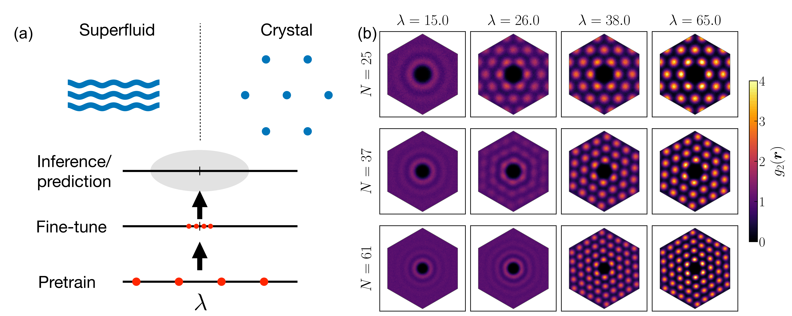

# BOSEFORMER

Neural quantum states (NQS) for modeling interacting bosons

**Author:** Daniil Antonenko (antonenko.daniel@gmail.com)

Preprint: [D. S. Antonenko, L. Fu, L. I. Glazman, *"Parametric neural-network wavefunctions across a bosonic phase transition"*, arXiv:2611.33150](https://arxiv.org/pdf/2611.33150). 

## Overview

Boseformer is a universal attention-based neural-network architecture for representing the wavefunctions of particles with bosonic quantum statistics, including superfluid and crystal phases. The model is trained to generate the wavefunction as a function of a Hamiltonian parameter across the quantum phase transition between these phases. Once trained with variational Monte Carlo optimization, it can serve as a foundation model describing the phase transition without the need to retrain it for individual parameter values.

The architecture uses a transformer backbone used in Psiformer ([https://github.com/google-deepmind/ferminet](https://github.com/google-deepmind/ferminet)). Product heads account for bosonic quantum statistics (permutation invariance). 

The typical usage workflow and the results for two-dimensional bosons with dipole-dipole ($1/r^3$) repulsion are shown in the figure below:



## Environment setup

```bash
git clone https://github.com/andanya/boseformer.git
cd boseformer
uv sync --locked
source .venv/bin/activate
```
GPU runs need a CUDA-compatible NVIDIA driver. For CPU-only setup, use `uv sync --locked --no-group cuda`. Run the examples below from the repository root.

## Usage

```bash
python scripts/dipole-pbc-hex-N25-pbc.py  # Hexagonal periodic cell, 1/r³ interaction (N=25).
python scripts/dipole-pbc-hex-N25-pbc-ft2040.py  # Fine-tune at lambda = 20, 25, 30, 35, 40.
python scripts/infer-dipole-pbc-hex-N25-pbc-ft2040.py 30.0  # Inference with the fine-tuned model at lambda = 30.

python scripts/bosef-10e-rep01.py         # Disk, short-range Gaussian interaction (N=10).
```

The `network` package uses these config fields:

| Field | Choices |
| --- | --- |
| `cfg.n_particles` | Number of bosons |
| `cfg.geometry` | `'periodic'` or `'disk'` |
| `cfg.lattice` | `config.make_lattice('hexagonal', L)` or `config.make_lattice('square', L)`; `None` for a disk |
| `cfg.disk_radius`, `cfg.center` | Disk radius and coordinate origin |
| `cfg.interaction_type` | `'inverse_cubic'` or `'short_range'` (Gaussian) |
| `cfg.interaction_ewald` | Exact periodic dipolar summation |
| `cfg.interaction_strength_training_set` | Couplings for conditional training; `None` for one coupling |
| `cfg.interaction_strength` | Coupling for single-lambda training or inference |
| `cfg.network.lambda_conditioning.mode` | `'additive'` (default), `'film'`, or `'none'` for an unconditioned model |
| `cfg.network.products` | Number of generalized-orbital products |

Geometry determines the input features and orbital envelope. The periodic
paper scripts also enable `cfg.network.smooth_periodic_jastrow`; retain it
when restoring their checkpoints. For a disk, disable Ewald and the periodic
Jastrow, and set `cfg.lattice = None`.

The training curves are saved to `train_stats.csv`.

The positions of Monte-Carlo walkers are saved to `walkers_last.host0.npy`.

## Observables

After the inference command above, compute a pair-correlation map from its latest checkpoint:

```bash
python observables/g2_map.py \
  --checkpoint dipole-25e-pbc-gen-HEX-smoothperiodic-bare-ft2040/lambda_30.0 \
  --config scripts/dipole-pbc-hex-N25-pbc-ft2040.py --lambda 30.0
```

Each script saves a CSV table and standalone PDF/PNG plots in `observable-results/` by default. See `--help` for sampling options; training-history scripts read `train_stats.csv`.

| Script | Output |
| --- | --- |
| `g2_map.py` | Two-dimensional pair correlation $g_2(\mathbf{r})$, one figure per coupling. |
| `bragg_peak.py` | Bragg peak height $S(\mathbf{k}_*)$ versus coupling or particle number. |
| `zero_momentum_occupation.py` | Zero-momentum occupation $n(0)$ or fraction $n(0)/N$. |
| `energy.py` | Total energy per particle versus coupling. |
| `kinetic_energy.py` | Kinetic energy per particle versus coupling. |
| `local_energy_variance.py` | Variance of individual local energies. |
| `energy_relative_to_jastrow.py` | Relative energy difference against an optimized pure-Jastrow baseline. |
| `variance_relative_to_jastrow.py` | Local-energy variance divided by the optimized pure-Jastrow variance. |
| `potential_energy.py` | Potential energy per particle versus coupling. |
| `structure_factor_map.py` | Reciprocal-space map $S(k_x,k_y)$. |
| `training_convergence.py` | Training energy per particle versus optimization step. |
| `training_variance.py` | Logged batch-mean energy variance versus optimization step. |
| `structure_factor_radial.py` | Angle-averaged static structure factor $S(k)$. |
| `feynman_bijl_dispersion.py` | Feynman–Bijl estimate of the collective-mode dispersion $\omega(k)$. |
| `g2_radial.py` | Angle-averaged pair correlation $g_2(r)$. |

## License

Apache 2.0
